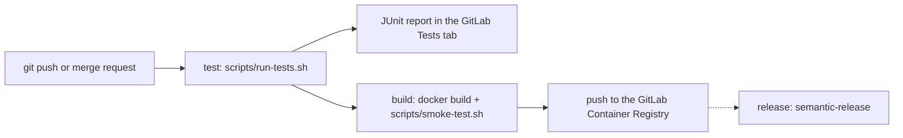

# Workshop Organizer Web API

[](https://gitlab.com/web-device-34-bouchet/workshop-organizer-api/-/pipelines?ref=main)

Welcome to the Workshop Organizer Web API! This application is designed to facilitate workshops open to the public. Whether you’re organizing coding bootcamps, art classes, or any other type of workshop, this API will help manage registrations, schedules, and resources.

## Table of Contents

1. Context
2. Technical Overview
3. Building and Running
4. Testing
5. Packaging
6. Publishing to GitLab Registry
7. Running with Docker Compose
8. CI/CD pipeline (GitLab)

## Context

Workshops play a crucial role in fostering learning and collaboration. Our application aims to streamline the workshop organization process, making it easier for organizers to manage participants, sessions, and materials. Whether you're a seasoned workshop host or just starting out, this API has got you covered!

## Technical Overview

- **Java Development Kit (JDK):** We use **JDK 21**, tested with **Adoptium**, to power our application.
- **Database:** Our backend relies on a **PostgreSQL 18** database for data storage.
- **Build Tool:** We leverage **Gradle 8.7** for managing dependencies and building the project.
- **Spring Boot:** Our application is based on **Spring Boot 3.2.4**, which provides a robust framework for creating RESTful APIs.
- **Application Server:** Our application can run on Tomcat server that require version 10.1.24.

## Building and Running

To compile and run the application locally, follow these steps:

1. Ensure you have JDK 21 installed.
2. Clone this repository.
3. Navigate to the project root directory.
4. Execute the following command to compile the Java code :
   ```bash
   ./gradlew clean compileJava
   ```
5. To run the application locally, either:
   Execute the main method in the Application class from your IDE.
   Use the Spring Boot Gradle Plugin :
   ```bash
   ./gradlew bootRun
   ```
   For production, package the application as WAR and use a tomcat server

## Running with Docker Compose

The stack runs two containers: the API (`app`, JRE image, non-root user) and
PostgreSQL 18 (`db`, official image without `gosu`, non-root user).

1. Create your local environment file (never committed, see `.gitignore`):
   ```bash
   cp .env.example .env
   sed -i "s/^POSTGRES_PASSWORD=.*/POSTGRES_PASSWORD=$(openssl rand -hex 24)/" .env
   ```
2. Build and start the stack:
   ```bash
   docker compose up -d
   ```
   The API waits until the database is healthy (`pg_isready` health check).
3. Check the API:
   - Swagger UI: http://localhost:8080
   - Example endpoint: http://localhost:8080/api/notions

Notes:
- The database port is not published on the host: only the API can reach it.
- Data is stored in the `db-data` volume: `docker compose down` keeps it,
  `docker compose down -v` deletes it.
- Use `docker compose config --quiet` to validate the file: without `--quiet`,
  the resolved password is printed.

## Configuration

You can configure the application with these environment variables

- SPRING_DATASOURCE_URL: JDBC URI for DB access (ex. jdbc:postgresql://db:5432/mydatabase)
- SPRING_DATASOURCE_USERNAME: Database user name used by the application
- SPRING_DATASOURCE_PASSWORD: Database user password used by the application

## Testing

We take testing seriously! To verify the correctness of our application, run the following command:

```bash
./gradlew clean test
```

During execution junit reports are generated in the `build/test-results/test` folder.

In CI, tests run through `./scripts/run-tests.sh`, which copies these
reports to `test-results/` (see [CI/CD pipeline](#cicd-pipeline-gitlab)).

## Packaging

When you’re ready to package the application for deployment, create a deployable WAR file:

```bash
./gradlew bootWar
```

The generated war file can be used with many application servers such as Tomcat, Wildfly...

## Publishing to GitLab Registry

To publish your application to a GitLab registry, follow these steps:

1. Set up your GitLab project.
2. Ensure you have the following environment variables configured:

   - GITLAB_PROJECT_ID: The ID of your GitLab project.
   - GITLAB_TOKEN_NAME: The name of the GitLab access token.
   - GITLAB_TOKEN: Your GitLab access token.

3. Execute the following command to publish your application:
   ```bash
   ./gradlew publish
   ```
   Remember to replace placeholders with actual values specific to your project.

Feel free to enhance this README with additional details, such as API endpoints, security considerations, and deployment instructions. Happy organizing! 🚀

## CI/CD pipeline (GitLab)

The same `.gitlab-ci.yml` is used in both repositories (Workshop Organizer
API and Olympic Participation Tracker). Each job only runs when the files of
its project type exist (`rules: exists`), so the pipeline adapts itself.



The dotted step (release) is planned and will be added next.

- **Triggers**: every branch push and every merge request (no duplicate
  pipeline when a merge request is open).
- **Test report**: `test-results/*.xml` is published as a JUnit report and
  kept even when tests fail (`artifacts: when: always`).
- **Cache**: dependencies are cached between pipelines. Measured on the API:
  Gradle tests went from 59 s to 17 s, and the whole pipeline from 1 min 32
  to 51 s.
- **Build** (branch pipelines only, after all tests passed): the image is
  built with Docker-in-Docker, started once by `scripts/smoke-test.sh`, and
  pushed only if it answers. Each image gets two tags: the branch name
  (`:main`, moves with the branch) and the short commit SHA (`:3a979237`,
  never changes).
- **Secrets**: the registry password is a temporary job token provided by
  GitLab, sent with `--password-stdin` (never printed) and removed at the end
  of the job (`docker logout` in `after_script`).

### Configuration differences between the two projects

| | Workshop Organizer API | Olympic Participation Tracker |
|---|---|---|
| Test job | `test:spring-boot` | `test:angular` |
| Runs when | `gradlew` exists | `angular.json` exists |
| CI image | `eclipse-temurin:21-jdk` | `node:24-bookworm-slim` + Chromium |
| Test command (inside `run-tests.sh`) | `./gradlew clean test` | `npm test` (Karma, headless Chrome) |
| Raw JUnit reports | `build/test-results/test/` | `reports/` |
| Cache | `.gradle/` (key: `build.gradle` + Gradle wrapper version) | `.npm/` (key: `package-lock.json`) |
| Build job | `build:image` (shared) | `build:image` (shared) |
| Docker image | multi-stage: JDK 21 + Gradle, then JRE 21 (WAR) | multi-stage: Node 24, then Nginx 1.30 |
| Smoke test (inside `smoke-test.sh`) | API + temporary PostgreSQL, `GET /api/notions` | Nginx, `GET /` |
| Registry image | `registry.gitlab.com/web-device-34-bouchet/workshop-organizer-api` | `registry.gitlab.com/web-device-34-bouchet/olympic-participation-tracker` |
| Compressed image size | 122.6 MB | 28.6 MB |

### Differences between local and CI environments

| | Local machine | GitLab CI |
|---|---|---|
| Tools | Java / Node installed on the machine | official images (`eclipse-temurin`, `node`, `docker`) |
| Browser for Angular tests | found automatically by `run-tests.sh` | Chromium installed by the job, `CHROME_BIN` set |
| Dependency cache | `~/.gradle`, `~/.npm` | `.gradle/` and `.npm/` inside the project (GitLab only caches project paths) |
| Docker | the machine's Docker daemon | Docker-in-Docker service (`docker:29-dind`) |
| Smoke test ports | none published (no conflict with apps already running, e.g. on 8080) | same script, same behaviour |
| Database credentials (API) | `.env` file, never committed (see `.env.example`) | random password generated for each smoke test |
| Registry login | not needed | temporary job token, logged out at the end of the job |

Run the same checks locally:

- `./scripts/run-tests.sh` (exit code 0 = OK, 1+ = failing tests,
  2 = unknown project, 3 = missing tool, 4 = no report);
- `docker build -t my-image . && ./scripts/smoke-test.sh my-image`
  (exit code 0 = the image answers, 1 = it does not, 2 = unknown project).
